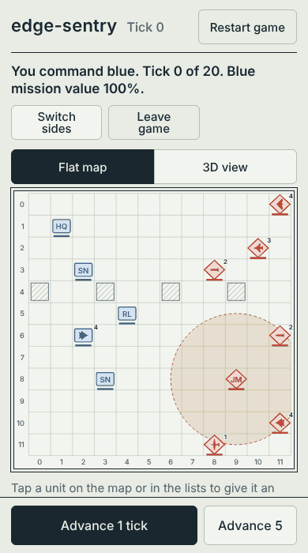

# edge-sentry

A 3D air and electronic-warfare sandbox for studying defensive autonomy. Blue's sensors track red aircraft, missiles and a jammer. A trained model scores each track, an autonomy planner runs the defense, and the same planner runs on its own as a small edge node. Every number below links to the generated report it comes from.

**[Play it in your browser](https://edge-sentry.replit.app)**, on a phone or a desktop. It opens in a Basic view that tells the battle in plain words: watch the computer play both sides, or defend or attack yourself. [Advanced](https://edge-sentry.replit.app/?level=advanced) is the full console.



## At a glance

- **Simulator, C++17.** A 12×12 map with six altitude levels, five aircraft types, jamming, terrain masking and point defense. Deterministic, so every result reproduces from a seed. 132 command-line checks.
- **Threat model.** Predicts whether a contact will harm a blue unit within 5 ticks, using only what blue can observe. [AUC 0.968 on held-out scenarios](edge-sentry/ml/RESULTS.md).
- **Autonomy planner.** Runs point defense and a fighter from one observation message, under hold-fire rules. [Mission value 0.974, against 0.889 undefended](edge-sentry/ml/AUTONOMY.md).
- **Edge node.** The same planner as a standalone program over TCP, also built for arm64. [The same orders on all 880 test ticks](edge-sentry/sil/RESULTS.md).
- **A learned policy.** A small network trained by reinforcement learning makes the planner's decisions from the same message, with hold-fire enforced as a mask on its choices. [It matches the planner on scripted rollouts (0.971) and beats it against red's doctrine (0.842 to 0.824)](edge-sentry/ml/RL.md).
- **A red side that fights back.** A coordinated strike doctrine beat the first planner, which was then taught to answer it. [Mission value 0.766 to 0.824, and its fighter survives 91% of battles instead of 56%](edge-sentry/ml/OPPONENT.md).
- **Noisy sensing.** Missed detections and position noise, fused by a Kalman tracker. [Position error 0.29 cells, against 0.54 without the tracker](edge-sentry/ml/TRACKING.md).
- **Console and agent.** A zero-dependency web console for phone and desktop, with a 3D view and a game you can play as red or blue against the computer. Basic tells each round in a sentence for a first-time visitor; Advanced shows the orders, threat scores and logs behind it. An LLM ops agent works the same simulator through five tools, and every order from anyone is logged with its reason and the threat picture it was made on.
- **ROS 2 bridge.** The observation and the plan as typed topics between two nodes, [checked in CI in the Jazzy image](edge-sentry/ros2/README.md).
- **Docker.** The console, the planner and the test tools as images; the planner's is one 2 MB file. [Software-in-the-loop across two containers](edge-sentry/docker/README.md).
- **Requirements.** [50 requirements, each linked to the automated check that verifies it](edge-sentry/docs/REQUIREMENTS.md).

## Run it

```bash
cd edge-sentry
docker compose up     # needs only Docker; console on http://localhost:3100
npm run web           # or without Docker: needs Node 20+ and g++
```

The full write-up, with the method, the limits and what did not work, is in [`edge-sentry/README.md`](edge-sentry/README.md).

Simulation and wargame math only. No real RF jammer designs, seeker guidance, or offensive cyber tooling.
