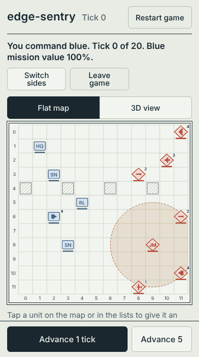
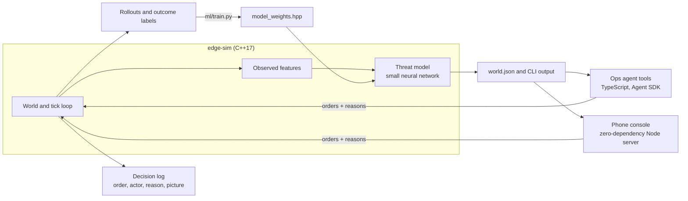

# edge-sentry

A small 3D air and electronic-warfare sandbox with trained threat models, an LLM ops agent, and a phone console.

**Live demo:** [edge-sentry.replit.app](https://edge-sentry.replit.app) (best on a phone; the sandbox is shared, so press Reset scenario to start clean)



Blue sensors watch red contacts on a 12×12 map with six altitude levels. Jets, stealth fighters, bombers, drones and missiles each fly differently: speed, climb rate, ceiling, how visible they are to sensors, and how low they must come to hit. Low flyers hide behind terrain, and point defense needs a usable track to stop anything. The question the project answers each tick: **which contacts are about to hurt us, and which one do we deal with first?** A C++ simulator produces the world, a small neural network trained on simulator rollouts scores every contact, and an agent (or you, from your phone) reads the picture and issues orders. Every order is written to a decision log with the threat picture it was made on.

Simulation and wargame math only. No real RF jammer designs, seeker guidance, or offensive cyber tooling.

## Results

**Prediction.** The model predicts whether a contact will harm a blue asset within 5 ticks, using only what blue could observe: motion, a few ticks of track history, emissions, and effects on blue units. It never sees a contact's orders or target. On 200 held-out random 3D scenarios (12,718 contact-ticks):

| Scorer | AUC | AUC, aircraft and missiles | F1 at hostile | Scripted scenarios passed |
| --- | --- | --- | --- | --- |
| **Learned model**, observable inputs only | **0.968** | 0.938 | **0.87** | **17 of 19** |
| Sequence model (PyTorch GRU), per-tick inputs only | 0.967 | 0.938 | 0.87 | 17 of 19 |
| Hand-set heuristic that reads the contact's real target | 0.868 | 0.942 | 0.59 | 16 of 19 |
| Original hand-set heuristic, observable inputs only | 0.742 | 0.585 | 0.10 | 11 of 19 |

**Outcomes.** Blue's HQ can defend against one contact per tick. Triage by score × severity, same rule for every scorer, over 150 random rollouts:

| Who decides what to defend against | Mission value | Hits taken per rollout |
| --- | --- | --- |
| Nobody (no defense) | 0.880 | 3.24 |
| Random contact | 0.911 | 2.58 |
| Original heuristic | 0.926 | 2.22 |
| Heuristic that reads the target | 0.935 | 1.96 |
| **Learned model** | **0.951** | **1.63** |
| **Sequence model (GRU)** | **0.954** | **1.57** |
| One-step lookahead (uses the simulator's future) | 0.980 | 0.84 |

Mission value is the average over every tick and blue asset of health × integrity. The learned model recovers 70% of the gain that lookahead gets over doing nothing, and the sequence model 74%.

**Does a recurrent model need the hand-built history?** No. The sequence model is a 16-unit GRU trained with PyTorch that gets only the 20 inputs describing the current tick and has to remember the track itself. It matches the default model on held-out AUC (0.967 vs 0.968), passes the same number of scripted scenarios, and is slightly ahead on outcomes (0.954 vs 0.951 mission value). That is a tie within noise, reached with less feature engineering. The default stays the smaller model; `--scorer sequence` switches to the GRU, and every track reports both scores.

Where it falls short: on aircraft and missiles alone, the heuristic that is allowed to read each contact's real target still ranks slightly better (0.942 vs 0.938 AUC); the models win overall and on every outcome measure. Both models fail the same two scripted scenarios: a jet that parks beside HQ without firing (read as benign; a human would keep watching) and a distant jammer that they call hostile before it has moved. They also need a tick or two of motion before they can read intent. Moving to 3D made the task harder: AUC was 0.978 on the earlier flat simulator.

Full tables and method: [`ml/RESULTS.md`](ml/RESULTS.md), [`ml/OUTCOMES.md`](ml/OUTCOMES.md), [`ml/README.md`](ml/README.md). Every number is regenerated by scripts in `ml/`, and CI fails if they slip.

## How it fits together



| Path | What it is |
| --- | --- |
| `native/` | C++ simulator and scorer: units, jam fields, engagements, track features, JSON CLI |
| `ml/` | Dataset generation, training, prediction and outcome evaluation, scripted scenarios |
| `bot/` | Agent instructions and five tools (`map_status`, `run_tick`, `issue_order`, `score_tracks`, `decision_log`) |
| `web/` | Phone console: `server.mjs`, `index.html`, `run.sh` |
| `evals/` | Agent evals: tool routing, and an outcome-graded eval that scores the agent's defensive decisions |

## Try it

Phone console, no model login and no `npm install`:

```bash
npm run web          # builds edge-sim if needed, serves http://localhost:3100
```

Tap a unit, give it a move, climb, dive, orbit, jam, launch, cease or defend order with an optional reason, and advance ticks. Switch between the flat map and a 3D view that shows altitude as height (drag sideways to turn it). The decision log at the bottom of the page shows each order with the threat picture at that moment. On Replit, import the repo and press Run; the root `.replit` file runs the same script.

**Play a side.** Press *Play as blue* or *Play as red* for a 20-tick game against the computer:

- As blue, red's missiles, bomber, jet, stealth fighter, drone and jammer come at you. You run the one point defense by hand and fly a stealth fighter that can shoot aircraft down.
- As red, you attack and the trained threat model runs blue's defense and its fighter, picking the contacts with the highest threat score weighted by how much damage they can do.

The score is blue's average mission value over the game, the same measure the outcome evaluation uses. You can only order your own side, the opponent's orders go into the decision log as actor `opponent`, and each visitor gets a separate world, so two people on the hosted demo do not disturb each other.

Agent playground:

```bash
npm install
npm run build:native
npx @grok/agent-sdk login   # once, for model turns
npx @grok/agent-sdk dev     # open http://127.0.0.1:3000/playground
```

Tests and model evaluation (Python standard library only):

```bash
npm test               # 91 CLI regression checks
npm run eval:model     # held-out metrics, 19 scenarios, C++/Python parity
npm run eval:outcome   # triage policies compared on outcomes (quick version)
```

Retraining needs numpy and scikit-learn: `python3 ml/train.py`, then rebuild. The sequence model needs PyTorch: `python3 ml/train_seq.py`, or run the *Train sequence model* workflow, which trains in GitHub Actions and commits the weights.

The agent's outcome eval (`evals/outcome.eval.ts`) seeds eight scenarios, lets the agent run the HQ's defense for 12 ticks, and scores the result against no defense and against the learned-model policy. It needs a model login: `npx @grok/agent-sdk eval --dir . --tag outcome`.

## Engineering notes

- The simulator is deterministic, so every result above reproduces exactly from a seed.
- Aircraft differ through one table of game numbers (speed, climb, ceiling, signature, damage, release altitude), not through special cases. Altitude matters three ways: attackers must descend to hit a ground target, track quality falls with slant range and behind cover at low level, and point defense cannot stop a contact it has no lock on. These are game rules, not real performance data.
- The scorer has two modes, `--scorer learned` (default) and `--scorer heuristic`, and every track reports both scores so they can be compared on identical worlds.
- The decision log (`<world>.decisions.jsonl`) is append-only: every order, spawn and reset, accepted or refused, with who issued it, the stated reason, and the threat picture beforehand. Option values are parsed as plain text, so no reason or unit id can switch logging off.
- The C++ model and the Python reference are checked against each other on every held-out row (they agree to within 1e-5).
- The GRU runs in plain C++ with no ML runtime: weights are compiled in, and each contact's hidden state is saved in the world file and advanced exactly once per tick, however many times the world is read in between.
- The web server passes validated arguments to the binary without a shell and serializes commands, so parallel requests cannot corrupt the world file.
- The computer opponent is a simulator command (`edge-sim opponent --side red|blue`), so its behavior is deterministic and covered by the CLI tests. Game rules (whose units you may order, the 20-tick limit, the score) are enforced on the server, not in the page.
- [`REVIEW_FINDINGS.md`](REVIEW_FINDINGS.md) records a code review of the first version: five bugs found, fixed, and covered by regression tests.

## Roadmap

1. Run the outcome-graded agent eval and compare the agent with the scripted triage policy
2. More than one defensive resource, so triage becomes an assignment problem
3. Detection that can lose a track entirely, so stealth and terrain hide contacts instead of only weakening them
4. Raspberry Pi field node behind the same JSON CLI

## Safety line

Engage and jam effects are abstract game labels for learning about systems and agents. Do not extend this repo into real weaponization or exploit code.
