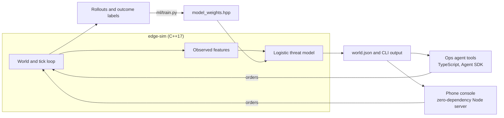

# edge-sentry

A small air and electronic-warfare sandbox with a trained threat model, an LLM ops agent, and a phone console.


Blue sensors watch red contacts on a 12×12 map. The question the project answers each tick: **which contacts are about to hurt us?** A C++ simulator produces the world, a logistic model trained on simulator rollouts scores every contact, and an agent (or you, from your phone) reads the picture and issues orders.

Simulation and wargame math only. No real RF jammer designs, seeker guidance, or offensive cyber tooling.

## Results

The model predicts whether a contact will harm a blue asset within 5 ticks, using only what blue could observe: motion, emissions, and effects on blue units. It never sees a contact's orders or target. On 200 held-out random scenarios (12,563 contact-ticks):

| Scorer | AUC | Precision at hostile | Recall at hostile | F1 | Scripted scenarios passed |
| --- | --- | --- | --- | --- | --- |
| **Learned model**, observable inputs only | **0.961** | 0.87 | **0.89** | **0.88** | **14 of 14** |
| Hand-set heuristic that reads the contact's real target | 0.896 | 0.88 | 0.49 | 0.63 | 12 of 14 |
| Original hand-set heuristic, observable inputs only | 0.799 | 0.49 | 0.05 | 0.09 | 9 of 14 |

Where it is weaker: on jets and missiles alone, the heuristic that peeks at the target still ranks slightly better (AUC 0.939 against 0.918). A contact flying toward a sensor looks the same whether it will attack or pass by, and the model has to wait for motion to tell them apart, so it cannot call anything hostile at tick 0.

Full tables, the 14 scenarios, and the method are in [`ml/RESULTS.md`](ml/RESULTS.md) and [`ml/README.md`](ml/README.md). Every number is regenerated by `python3 ml/evaluate.py`, and CI fails if they slip.

## How it fits together



| Path | What it is |
| --- | --- |
| `native/` | C++ simulator and scorer: units, jam fields, engagements, track features, JSON CLI |
| `ml/` | Dataset generation, training, evaluation, scripted scenarios |
| `bot/` | Agent instructions and four tools (`map_status`, `run_tick`, `issue_order`, `score_tracks`) |
| `web/` | Phone console: `server.mjs`, `index.html`, `run.sh` |
| `evals/` | Agent evals (tool routing) |

## Try it

Phone console, no model login and no `npm install`:

```bash
npm run web          # builds edge-sim if needed, serves http://localhost:3100
```

Tap a unit, give it a move, jam, launch or cease order, and advance ticks. On Replit, import the repo and press Run; the root `.replit` file runs the same script.

Agent playground:

```bash
npm install
npm run build:native
npx @grok/agent-sdk login   # once, for model turns
npx @grok/agent-sdk dev     # open http://127.0.0.1:3000/playground
```

Tests and model evaluation (Python standard library only):

```bash
npm test             # 37 CLI regression checks
npm run eval:model   # held-out metrics, 14 scenarios, C++/Python parity
```

Retraining needs numpy: `python3 ml/train.py`, then rebuild.

## Engineering notes

- The simulator is deterministic, so every result above reproduces exactly from a seed.
- The scorer has two modes, `--scorer learned` (default) and `--scorer heuristic`, and every track reports both scores so they can be compared on identical worlds.
- The C++ model and the Python reference are checked against each other on every held-out row (they agree to within 1e-5).
- The web server passes validated arguments to the binary without a shell and serializes commands, so parallel requests cannot corrupt the world file.
- [`REVIEW_FINDINGS.md`](REVIEW_FINDINGS.md) records a code review of the first version: five bugs found, fixed, and covered by regression tests.

## Roadmap

1. Line of sight and terrain masking, so cover affects detection
2. A model with memory (a few ticks of track history) to separate attack runs from fly-bys earlier
3. Agent evals that grade the quality of recommended orders, not only tool choice
4. Raspberry Pi field node behind the same JSON CLI

## Safety line

Engage and jam effects are abstract game labels for learning about systems and agents. Do not extend this repo into real weaponization or exploit code.
