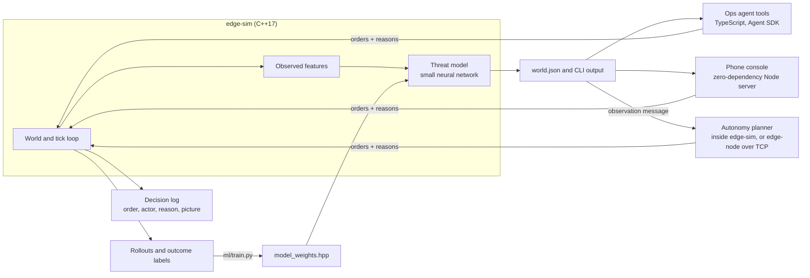

# edge-sentry

A small 3D air and electronic-warfare sandbox with trained threat models, an autonomy planner that runs on a separate edge node, an LLM ops agent, and a console for phone and desktop.

**Live demo:** [edge-sentry.replit.app](https://edge-sentry.replit.app) (best on a phone; the sandbox is shared, so press Reset scenario to start clean)


Blue sensors watch red contacts on a 12×12 map with six altitude levels. Jets, stealth fighters, bombers, drones and missiles each fly differently: speed, climb rate, ceiling, how visible they are to sensors, and how low they must come to hit. Low flyers hide behind terrain, and point defense needs a usable track to stop anything. The question the project answers each tick: **which contacts are about to hurt us, and which one do we deal with first?** A C++ simulator produces the world, a small neural network trained on simulator rollouts scores every contact, and an agent (or you, from your phone) reads the picture and issues orders. Every order is written to a decision log with the threat picture it was made on.

Simulation and wargame math only. No real RF jammer designs, seeker guidance, or offensive cyber tooling.

## Results

**Prediction.** The model predicts whether a contact will harm a blue asset within 5 ticks, using only what blue could observe: motion, a few ticks of track history, emissions, and effects on blue units. It never sees a contact's orders or target. On 200 held-out random 3D scenarios (12,718 contact-ticks):

| Scorer | AUC | AUC, aircraft and missiles | F1 at hostile | Scripted scenarios passed |
| --- | --- | --- | --- | --- |
| **Learned model**, observable inputs only | **0.968** | 0.938 | **0.87** | **17 of 19** |
| Sequence model (PyTorch GRU), per-tick inputs only | 0.967 | 0.938 | 0.87 | 17 of 19 |
| Hand-set heuristic that reads the contact's real target | 0.868 | 0.942 | 0.59 | 16 of 19 |
| Original hand-set heuristic, observable inputs only | 0.742 | 0.585 | 0.10 | 11 of 19 |

**Outcomes.** Blue's HQ can defend against one contact per tick. Triage by score × severity, same rule for every scorer, over 150 random rollouts:

| Who decides what to defend against | Mission value | Hits taken per rollout |
| --- | --- | --- |
| Nobody (no defense) | 0.880 | 3.24 |
| Random contact | 0.911 | 2.58 |
| Original heuristic | 0.926 | 2.22 |
| Heuristic that reads the target | 0.935 | 1.96 |
| **Learned model** | **0.951** | **1.63** |
| **Sequence model (GRU)** | **0.954** | **1.57** |
| One-step lookahead (uses the simulator's future) | 0.980 | 0.84 |

Mission value is the average over every tick and blue asset of health × integrity. The learned model recovers 70% of the gain that lookahead gets over doing nothing, and the sequence model 74%.

**Autonomy.** A planner (`native/src/autonomy.cpp`) runs blue's whole defense from the observation message alone: which contact point defense covers each tick, and how the fighter flies (patrol, shadow, intercept, engage, return to base). It estimates the loss each contact will cause at each coming tick, gives point defense to whatever can do the most damage next, and sends the fighter after the contact whose removal saves the most. Over 150 rollouts where blue has point defense and one fighter:

| Who runs the defense | Mission value | Hits taken | Aircraft shot down that never attacked |
| --- | --- | --- | --- |
| Nobody | 0.889 | 4.06 | 0 |
| Point defense by score x damage, fighter idle | 0.949 | 2.20 | 0 |
| Same, fighter takes the next most dangerous aircraft | 0.962 | 1.23 | 0.34 |
| Same, fighter chases the nearest aircraft | 0.968 | 0.89 | 1.12 |
| **Autonomy planner** | **0.974** | **0.83** | **0.11** |

The last column matters because the simulator does not punish shooting an aircraft that was only passing through, so a fighter that shoots at everything scores well. The planner holds fire on any contact the threat model has not flagged and follows it instead; that rule costs 0.003 of mission value and cuts those shoot-downs from 0.66 to 0.11 per rollout. Timing point defense is the part that pays (+0.009). Two things I expected to help did not measurably: flying to where a target will be instead of straight at it, and waiting at a forward patrol station. Both are left on and reported in [`ml/AUTONOMY.md`](ml/AUTONOMY.md).

**On a separate computer.** The same planner builds as `edge-node`, a standalone program with no simulator in it, and a software-in-the-loop harness runs the simulator against it over TCP ([`sil/`](sil/README.md)):

| Check | Result |
| --- | --- |
| Ticks where the node's orders differed from the in-simulator planner | 0 of 880 |
| Planning time in the node, median and 99th percentile | 37 µs and 109 µs |
| TCP round trip, median and 99th percentile | 0.25 ms and 0.42 ms |
| Mission value on a direct link, losing 30% of messages, losing 60%, link down | 0.970, 0.964, 0.950, 0.878 |

A reply that misses the 50 ms tick budget is thrown away and units keep their last orders, so a bad link degrades gradually and a dead one is exactly as good as no autonomy (0.878), never worse. Those timings are from the development machine. CI also cross-compiles the node for arm64 and runs the same tests under emulation, which shows the build is right for a Raspberry Pi or Jetson but says nothing about their speed; it has not been timed on a physical device yet.

**A red side that fights back.** Red's computer opponent used to launch everything at once at the nearest target, and in the free sandbox red did nothing at all unless ordered. It now flies a coordinated doctrine: faster attackers hold so the strike arrives together (one point defense can stop only one hit per tick), jets, drones and the stealth fighter come in at level 1 where cover hides them, the jammer drives to headquarters first, and the stealth fighter goes after blue's fighter. Both sides flown by the computer over 80 random battles:

| Red flown by | Blue flown by | Blue mission value | Blue's fighter survives |
| --- | --- | --- | --- |
| Original script | the planner | 0.843 | 100% |
| Coordinated doctrine | nobody | 0.636 | 54% |
| Coordinated doctrine | the planner, before the two lessons below | 0.766 | 56% |
| Coordinated doctrine | **the planner** | **0.824** | **91%** |

The third row is where the planner stood at first: it lost its fighter in almost half the battles. My first fix (count every armed contact as a threat to the fighter) made results worse. Instead of dropping it I replayed the losses, and they showed two rules working against the fighter:

- **Self-defense.** A damaged fighter turned for home with a hunter as fast as it is on its tail, and hold-fire stopped it shooting back at a hunter the threat model scored low. A contact that has hit one of blue's aircraft is now hostile whatever its score, the fighter fights it instead of running, and point defense may cover it. Alone this gets 0.815 and 91%.
- **Pressing on.** With that fixed, the fighter won its duel, came out damaged, and sat over headquarters for a third of the remaining battle while jets and drones kept hitting sensors. Nothing is repaired there. A damaged fighter now starts no fight with an armed aircraft that has done nothing yet, but keeps attacking aircraft that cannot shoot back and aircraft already seen hitting a blue unit. Red aircraft shot down go from 1.90 to 2.54 per battle.

Both were tuned on separate battles and then measured on these, and neither changes the 150-rollout table above (0.974, 0.11). Going one step further and treating a fighter that closes to two cells as hostile before it fires gets 0.832 and 94% here but shoots down more aircraft that never attacked (0.19 against 0.11), so it is not the default. Full table, with each lesson on its own: [`ml/OPPONENT.md`](ml/OPPONENT.md).

**ROS 2.** The same observation and plan are also typed ROS 2 messages ([`ros2/`](ros2/README.md)): the simulator and the planner run as two separate nodes that talk over topics. CI builds both packages in the official ROS 2 Jazzy container, runs the two nodes, and checks from a third node that every plan on the topic is exactly what the planner gives for that observation and that the orders take effect.

**Docker.** `docker compose up` runs the console and the planner with nothing installed but Docker ([`docker/`](docker/README.md)). The planner's image is a single 2 MB statically linked file on an empty base, and it builds for arm64 without emulating a compiler. `docker compose run --rm sil` repeats the software-in-the-loop test with a real boundary: the simulator in one container, the planner in another held to half a CPU core and 32 MB, talking only over the network. Every container runs as a non-root user on a read-only filesystem with no Linux capabilities, and CI checks that from outside, down to what the kernel reports.

**Requirements.** [`docs/REQUIREMENTS.md`](docs/REQUIREMENTS.md) lists 43 requirements (rules of engagement, interface, sensing, model, simulator, web console, containers) and the automated checks that verify each one. CI fails if a named check is renamed or removed, or a requirement is left without one.

**Noisy sensors.** Everything above uses a perfect picture. With sensing noise on (`edge-sim sensing --noise 0.7`), each sensor detects a contact only some of the time and reports a position that is a little off, worse at range, at low signature, behind cover and under jamming. A per-contact Kalman filter fuses the sensors' reports, rides through gaps of up to three ticks, then drops the track. The threat model and the planner see only that picture. Over 100 rollouts under heavy noise:

| Picture | Position error | Tracks lost per rollout | Threat AUC | Mission value with the planner |
| --- | --- | --- | --- | --- |
| Perfect | 0 | 0 | 0.975 | 0.976 |
| Heavy noise, best single detection (no tracker) | 0.54 cells | 1.96 | 0.878 | 0.963 |
| Heavy noise, tracker | 0.29 cells | 0.01 | 0.916 | 0.970 |
| Heavy noise, tracker, model retrained on noisy tracks | 0.29 cells | 0.01 | 0.963 | not yet run |

The tracker halves the position error and almost never loses a contact. The shipped threat model, trained only on the perfect picture, still loses 0.06 of AUC under heavy noise; retraining the same network on tracker output at mixed noise levels wins most of that back (0.963) and costs 0.001 on the perfect picture. That retrained model is an experiment and is not the default yet, so its effect on mission value is not measured. Detections also arrive already matched to a contact: telling contacts apart is not modelled. Full table: [`ml/TRACKING.md`](ml/TRACKING.md).

**Does a recurrent model need the hand-built history?** No. The sequence model is a 16-unit GRU trained with PyTorch that gets only the 20 inputs describing the current tick and has to remember the track itself. It matches the default model on held-out AUC (0.967 vs 0.968), passes the same number of scripted scenarios, and is slightly ahead on outcomes (0.954 vs 0.951 mission value). That is a tie within noise, reached with less feature engineering. The default stays the smaller model; `--scorer sequence` switches to the GRU, and every track reports both scores.

Where it falls short: on aircraft and missiles alone, the heuristic that is allowed to read each contact's real target still ranks slightly better (0.942 vs 0.938 AUC); the models win overall and on every outcome measure. Both models fail the same two scripted scenarios: a jet that parks beside HQ without firing (read as benign; a human would keep watching) and a distant jammer that they call hostile before it has moved. They also need a tick or two of motion before they can read intent. Moving to 3D made the task harder: AUC was 0.978 on the earlier flat simulator.

Full tables and method: [`ml/RESULTS.md`](ml/RESULTS.md), [`ml/OUTCOMES.md`](ml/OUTCOMES.md), [`ml/README.md`](ml/README.md). Every number is regenerated by scripts in `ml/`, and CI fails if they slip.

## How it fits together



| Path | What it is |
| --- | --- |
| `native/` | C++ simulator and scorer: units, jam fields, engagements, track features, JSON CLI |
| `ml/` | Dataset generation, training, prediction and outcome evaluation, scripted scenarios |
| `bot/` | Agent instructions and five tools (`map_status`, `run_tick`, `issue_order`, `score_tracks`, `decision_log`) |
| `native/node/` | `edge-node`: the autonomy planner as a standalone TCP program for an edge computer |
| `sil/` | Software-in-the-loop harness, link emulation and results |
| `docs/INTERFACE.md` | The message contract between the picture and the autonomy |
| `docs/REQUIREMENTS.md` | Each requirement and the checks that verify it (generated by `tools/trace.py`) |
| `ros2/` | ROS 2 messages and two nodes that run the simulator and the planner over topics |
| `Dockerfile`, `compose.yaml`, `docker/` | Images for the console, the planner and the test tools; the compose stack; the check that runs them |
| `web/` | Phone console: `server.mjs`, `index.html`, `run.sh` |
| `evals/` | Agent evals: tool routing, and an outcome-graded eval that scores the agent's defensive decisions |

## Try it

Console for phone and desktop, no model login and no `npm install`:

```bash
npm run web          # builds edge-sim if needed, serves http://localhost:3100
```

Tap a unit, give it a move, climb, dive, orbit, jam, launch, cease or defend order with an optional reason, and advance ticks. The 3D view (the default) draws every aircraft as a figure at its altitude with a shadow below it, nose up or down as it climbs or dives, banked while it orbits, and missiles leave a bright trail; drag sideways to turn it, or switch to the flat map. On a wide screen the map fills the left side and stays in view while contacts, orders and logs sit in a panel on the right (Space advances a tick, the arrow keys turn the view). The decision log at the bottom of the page shows each order with the threat picture at that moment. On Replit, import the repo and press Run; the root `.replit` file runs the same script.

**Play a side.** Press *Play as blue* or *Play as red* for a 20-tick game against the computer:

- As blue, red's missiles, bomber, jet, stealth fighter, drone and jammer come at you. You run the one point defense by hand and fly a stealth fighter that can shoot aircraft down.
- As red, you attack and the autonomy planner runs blue's defense and its fighter, working from the trained threat model's scores.
- On either side you can switch **Autopilot** on and the computer flies your side as well: the autonomy planner for blue, the coordinated strike for red. Switch it off and your units do nothing until you order them.
- In the free sandbox (no game), **Red autopilot** is on by default so the scenario plays out as you advance time, and **Blue autopilot** can be switched on to watch both computers fight. Turn Red autopilot off to order red units yourself.

The score is blue's average mission value over the game, the same measure the outcome evaluation uses. You can only order your own side. The opponent's orders go into the decision log as actor `opponent` and your own side's autopilot as `autopilot`, each with its reason. Each visitor gets a separate world, game and autopilot switches, so people on the hosted demo do not disturb each other; a test runs twelve visitors at once to check that.

Agent playground:

```bash
npm install
npm run build:native
npx @grok/agent-sdk login   # once, for model turns
npx @grok/agent-sdk dev     # open http://127.0.0.1:3000/playground
```

Or with Docker and nothing else installed:

```bash
docker compose up              # console on http://localhost:3100
docker compose run --rm sil    # simulator and planner in separate containers
python3 docker/check.py        # build the images and check how they run
```

Tests and model evaluation (Python standard library only):

```bash
npm test               # 122 CLI checks and 47 planner checks
npm run test:web       # twelve visitors at once on the web console: both sides, autopilot on and off
npm run trace          # every requirement still names a check that exists
npm run eval:model     # held-out metrics, 19 scenarios, C++/Python parity
npm run eval:outcome   # triage policies compared on outcomes (quick version)
npm run eval:autonomy  # the planner against simpler defense rules (quick version)
npm run eval:opponent  # red's coordinated doctrine against the original script (quick version)
npm run eval:tracking  # noisy sensing: tracker against no tracker (quick version)
npm run sil            # simulator against a separate edge-node over TCP
```

Retraining needs numpy and scikit-learn: `python3 ml/train.py`, then rebuild. The sequence model needs PyTorch: `python3 ml/train_seq.py`, or run the *Train sequence model* workflow, which trains in GitHub Actions and commits the weights.

The agent's outcome eval (`evals/outcome.eval.ts`) seeds eight scenarios, lets the agent run the HQ's defense for 12 ticks, and scores the result against no defense and against the learned-model policy. It needs a model login: `npx @grok/agent-sdk eval --dir . --tag outcome`.

## Engineering notes

- The simulator is deterministic, so every result above reproduces exactly from a seed.
- Aircraft differ through one table of game numbers (speed, climb, ceiling, signature, damage, release altitude), not through special cases. Altitude matters three ways: attackers must descend to hit a ground target, track quality falls with slant range and behind cover at low level, and point defense cannot stop a contact it has no lock on. These are game rules, not real performance data.
- The scorer has two modes, `--scorer learned` (default) and `--scorer heuristic`, and every track reports both scores so they can be compared on identical worlds.
- The decision log (`<world>.decisions.jsonl`) is append-only: every order, spawn and reset, accepted or refused, with who issued it, the stated reason, and the threat picture beforehand. Option values are parsed as plain text, so no reason or unit id can switch logging off.
- The C++ model and the Python reference are checked against each other on every held-out row (they agree to within 1e-5).
- The GRU runs in plain C++ with no ML runtime: weights are compiled in, and each contact's hidden state is saved in the world file and advanced exactly once per tick, however many times the world is read in between.
- The web server passes validated arguments to the binary without a shell and serializes commands, so parallel requests cannot corrupt the world file.
- The computer opponent is a simulator command (`edge-sim opponent --side red|blue`), so its behavior is deterministic and covered by the CLI tests. Game rules (whose units you may order, the 20-tick limit, the score) are enforced on the server, not in the page.
- Because the simulator is deterministic, visitors who do the same thing must get exactly the same result. `web/test_sessions.py` uses that: it runs twelve visitors in parallel on different sides and fails if any two that should match differ, which is how it would catch one visitor's game leaking into another's.
- Sensor noise is drawn from a hash of the seed, tick, contact and sensor rather than a running generator, so a noisy run replays exactly and does not depend on how many times the world was read. With noise at 0 the tracker is skipped entirely and every earlier result is unchanged.
- The planner node is one thread that watches every connection with `poll()`, so a health probe or a second client is answered while another stays connected, and it stops at once on a stop request because there is nothing to save.
- The planner keeps nothing between ticks. Everything it needs is in the observation, so the in-simulator copy and the edge node cannot drift apart, and a node that restarts is correct again on the next message. The observation never contains a contact's orders or target; the only hint of intent is which blue unit it has just hit, which blue can see for itself. Tests check both.
- The planner's rules are pinned by 47 checks that hand it written-out observations (no simulator involved): which contact gets point defense, when the fighter engages, shadows, breaks off, goes home, or stays in the fight when damaged.
- [`REVIEW_FINDINGS.md`](REVIEW_FINDINGS.md) records a code review of the first version: five bugs found, fixed, and covered by regression tests.

## Roadmap

1. Time the edge node on a physical Raspberry Pi or Jetson (`sil/README.md` has the two commands)
2. A learned policy (reinforcement learning) compared with the planner on the same rollouts
3. Make the noise-trained threat model the default and re-run every evaluation on it; then drop the assumption that detections arrive already matched to a contact
4. Teach the planner to break up a strike timed to arrive together, which is how red's doctrine still gets hits through
5. Link the planner into a C++ ROS 2 node and measure it over a lossy link
6. Run the outcome-graded agent eval and compare the agent with the planner

## Safety line

Engage and jam effects are abstract game labels for learning about systems and agents. Do not extend this repo into real weaponization or exploit code.
