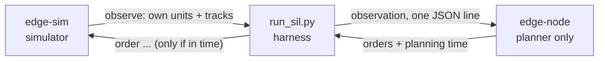

# Software-in-the-loop: the autonomy on its own computer

The planner that runs blue's defense (`native/src/autonomy.cpp`) is built twice:

- inside the simulator, as `edge-sim autopilot`
- as `edge-node`, a small standalone program for a separate computer. It has no
  simulator in it: only the planner and the message format (about 600 lines of
  C++17, no libraries beyond the standard one and POSIX sockets).

`run_sil.py` wires the two together. Each tick it asks the simulator for blue's
observation, sends it to the node over TCP, and gives the simulator the orders
that come back in time.



## Run it

```bash
npm run build:native
npm run sil                      # quick check: local node, 12 rollouts
python3 sil/run_sil.py           # full run, rewrites sil/RESULTS.md
```

Results are in [`RESULTS.md`](RESULTS.md). What it checks:

| Check | Why it matters |
| --- | --- |
| The node gives the same orders as the planner inside the simulator, every tick | The code that was evaluated is the code that is deployed |
| Planning time and TCP round trip, median to worst case | Whether it fits inside a tick |
| No reply misses the tick budget on a direct link | The deadline is real: a late reply is thrown away |
| Mission value with delay, jitter and lost messages | Degrades gradually; units keep their last orders |
| With the link down, nothing from the node is used | A dead link behaves exactly like no autonomy, never worse |

## On a Raspberry Pi or Jetson

On the device (any 64-bit Linux with g++):

```bash
git clone https://github.com/SergioB03/edge-sentry && cd edge-sentry/edge-sentry
g++ -std=c++17 -O2 -Inative/src native/node/edge_node.cpp native/src/autonomy.cpp -o edge-node
./edge-node --listen 7700 --bind 0.0.0.0
```

On the machine with the simulator:

```bash
python3 sil/run_sil.py --node raspberrypi.local:7700 --label "Raspberry Pi 5 over Wi-Fi"
```

That rewrites `RESULTS.md` with the device's own numbers.

## What has and has not been measured

- **Measured:** a local node on the development machine (x86-64), and in CI an
  arm64 build of the node running under QEMU emulation, which passes the same
  planner tests and the same agreement checks.
- **Not yet measured:** a physical Pi or Jetson. Emulation proves the arm64
  build is correct, but its timing says nothing about real hardware, so no
  device latency is claimed here. The two commands above produce it.
- The node has no authentication and listens only on this machine unless
  `--bind` says otherwise. Use it on a network you trust.
- The link emulation adds delay to the clock and drops messages in the
  harness. It does not reorder or corrupt them.
